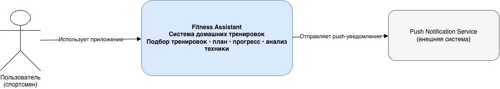
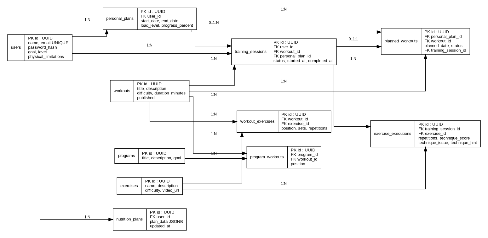

# Fitness Assistant — архитектурный паспорт

Архитектурный паспорт клиент-серверного приложения для самостоятельных домашних тренировок. Проект продолжает предметную область и DDD-модель лабораторных работ № 1–2.

## Содержание репозитория

```text
fitness-architecture-passport/
├── README.md
├── .gitignore
└── docs/
    └── architecture/
        ├── ADR-001.md
        ├── c4-diagram.drawio
        ├── openapi.yaml
        ├── er-diagram.dbml
        └── er-diagram.png
```

## Проект и границы

Система помогает пользователю подобрать тренировку, начать и провести сессию, получить оценку техники, завершить занятие и сохранить прогресс. Выделены пять bounded contexts:

1. Профиль пользователя;
2. Каталог тренировок;
3. Персональный план и прогресс;
4. Проведение тренировки и анализ техники;
5. Питание.

## Архитектурное решение

Выбрана **модульная монолитная архитектура**: один backend и один процесс развертывания, внутри — изолированные модули/контексты с контрактами. Это сохраняет быстрый старт и простоту эксплуатации, но позволяет контролировать границы и при необходимости выделять модуль в сервис. Подробное обоснование — [ADR-001](docs/architecture/ADR-001.md).

Клиент использует локальное хранилище и Offline-First подход: сеть актуализирует данные, но не должна блокировать запуск интерфейса и доступ к ранее сохраненным данным.

## Артефакты

- [ADR-001 — выбор архитектуры](docs/architecture/ADR-001.md)
- [C4 — System Context + Container (draw.io)](docs/architecture/c4-diagram.drawio)
- [OpenAPI 3.1](docs/architecture/openapi.yaml)
- [ER-модель (DBML)](docs/architecture/er-diagram.dbml)
- [ER-диаграмма (PNG)](docs/architecture/er-diagram.png)

## Просмотр диаграмм

- C4: открыть `c4-diagram.drawio` в [draw.io](https://app.diagrams.net/) или посмотреть PNG.
- OpenAPI: открыть `openapi.yaml` в [Swagger Editor](https://editor.swagger.io/).
- ER: открыть `er-diagram.dbml` в [dbdiagram.io](https://dbdiagram.io/) или посмотреть PNG.

## API и безопасность

API версионируется префиксом `/api/v1`. Для защищенных операций используется Bearer JWT. Пароль передается только при регистрации/входе по HTTPS; в базе хранится его хэш, а не исходное значение.

## Основные сценарии

1. Пользователь регистрируется или входит.
2. Просматривает каталог и фильтрует тренировки по критериям.
3. Получает персональный план.
4. Начинает тренировочную сессию, фиксирует выполнение упражнений и результаты анализа техники.
5. Завершает сессию; событие `WorkoutCompleted` приводит к обновлению прогресса (`ProgressUpdated`) и, при необходимости, рекомендаций питания.
6. Клиент синхронизирует локальное состояние с сервером.

## Ограничения модели

Это архитектурный проект, а не описание уже реализованного production-сервиса. Анализ техники представлен предметным результатом (оценка, ошибка, подсказка); алгоритм Computer Vision и хранение исходного видео не специфицированы. Push Notification Service показан как внешний интегратор, но его API не входит в данный OpenAPI.

## Архитектурные диаграммы

### C4 — System Context


### ER-диаграмма базы данных

